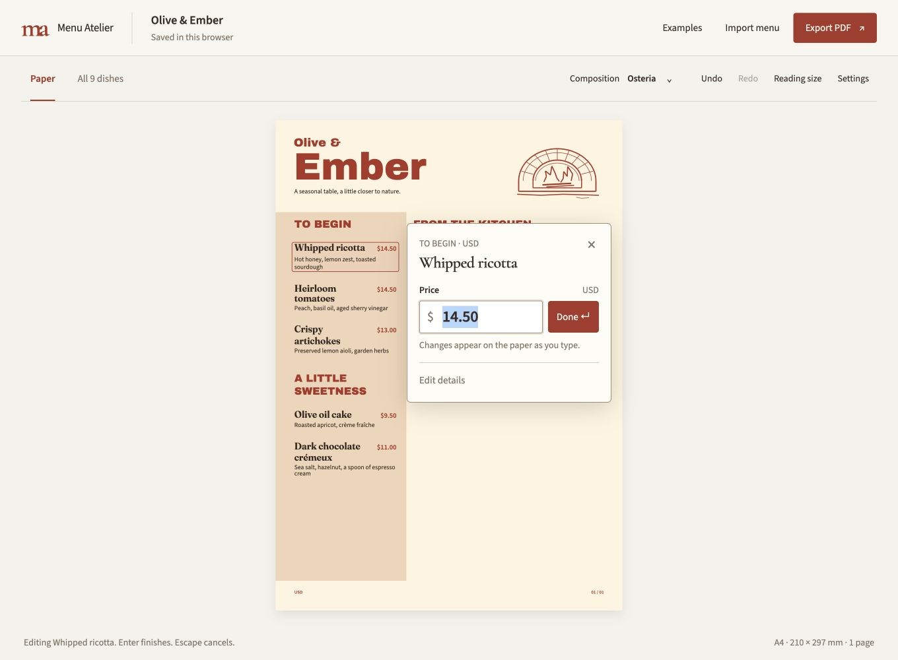

# Menu Atelier

An editable restaurant menu studio. Import a menu, review its dishes and prices, choose a design, edit the content, and download a PDF.

## Project links

- [Public source repository](https://github.com/VasuBansal7576/menu-atelier).
- [Recorded browser demo](dist/grading/demo.mp4), 1 minute 33.5 seconds.
- [Twelve menu PDFs and editable backups](dist/grading/).
- [Private studio](https://menu-atelier-vasu-oct26.zippy17.chatgpt.site) and [grading gallery](https://menu-atelier-vasu-oct26.zippy17.chatgpt.site/grading/). Sign in with the owner account.



Four compositions use licensed local fonts and a shared measured scene for preview and selectable PDF. Osteria is an asymmetric dining sheet. Herbarium pairs ink illustration with restaurant typography. Counter is a landscape service index. Table cards use A5 or Half Letter pages. pdf-lib writes the final scene and fontkit measures the embedded font bytes.

## Run the studio

Use Node.js 22.13 or newer.

```sh
npm install
npm start
```

Open the localhost address printed by the server. The core editing and PDF workflow requires no API key. Drafts stay in the current browser. Export JSON to keep a portable backup.

## Verify a real price change

1. Open an attributed restaurant example.
2. Select a printed price and change it beside the dish. Press Enter or Done to save the edit.
3. Check the new price in the paper preview.
4. Switch to another design and check that the edit remains.
5. Download the PDF and find the changed price in its selectable text.

Run `npm test` for 40 behavior and integration checks. Run `node scripts/grade.mjs --publish-assets` to reproduce all 12 grading PDFs, every rendered page and editable backups. Thumbnail generation requires Poppler's `pdftoppm`. Optional `python scripts/verify-grading.py` requires `pypdf` and checks the actual files. Integrated browser and PDF evidence is recorded in `devpost/verification.md`. The private deployment includes a `/grading/` gallery and a 93.50-second actual browser demo.

Run `node scripts/demo-proof.mjs` to reproduce the original before/after demonstration PDFs.

The [edited original-demo PDF](dist/grading/olive-and-ember-price-change.pdf) contains the recorded $12.00 to $14.50 change. The [grading gallery](dist/grading/index.html) starts with three selected restaurant studies and includes all twelve exports.

## Understand the files

The root `scope.md`, `prd.md` and `spec.md` mirror the canonical planning files in `devpost/`. `devpost/checklist.md` records build progress and distinguishes agent checks from the user's final review. `research/sources.md` records the official restaurant sources and their limitations. `devpost/app-map.html` explains the finished implementation.

## Know the boundaries

Menu recognition requires review. OCR can misread names and prices. The app does not infer allergen safety. Example menus are unofficial selections and are not endorsed by the restaurants. Pizzeria Bianco's source PDF is a documented April 2023 snapshot linked by the official site at retrieval time. Prices and availability can change.

AI helped plan, write, design and verify this software using the Devpost Learn Skill Pack. Runtime import uses parsing, PDF text extraction and OCR. It does not require or claim an online generative model.

## Hackathon preparation

Built from an empty project folder on 2026-10-26 for [Build With AI Basics](https://learn-ai-basics.devpost.com/). The required [Devpost Learn Skill Pack](https://github.com/challengepost/learn-ai-basics) is installed locally and its six stages were consulted. The user's explicit autonomous-build instruction adapted the repeated conversational approval checkpoints. The records do not claim unperformed interviews, learner testing or reflection.

The public repository includes the source, planning files, menu PDFs, and recorded demo. The hackathon separately requires the demo on public YouTube or Vimeo. That upload, the entrant-written submission answers, the exit survey, and the final Devpost entry remain pending. The private app audience is unchanged.

## License

Application code is MIT licensed. Restaurant facts and names remain attributed to their sources. Third-party dependencies retain their own licenses and notices.
