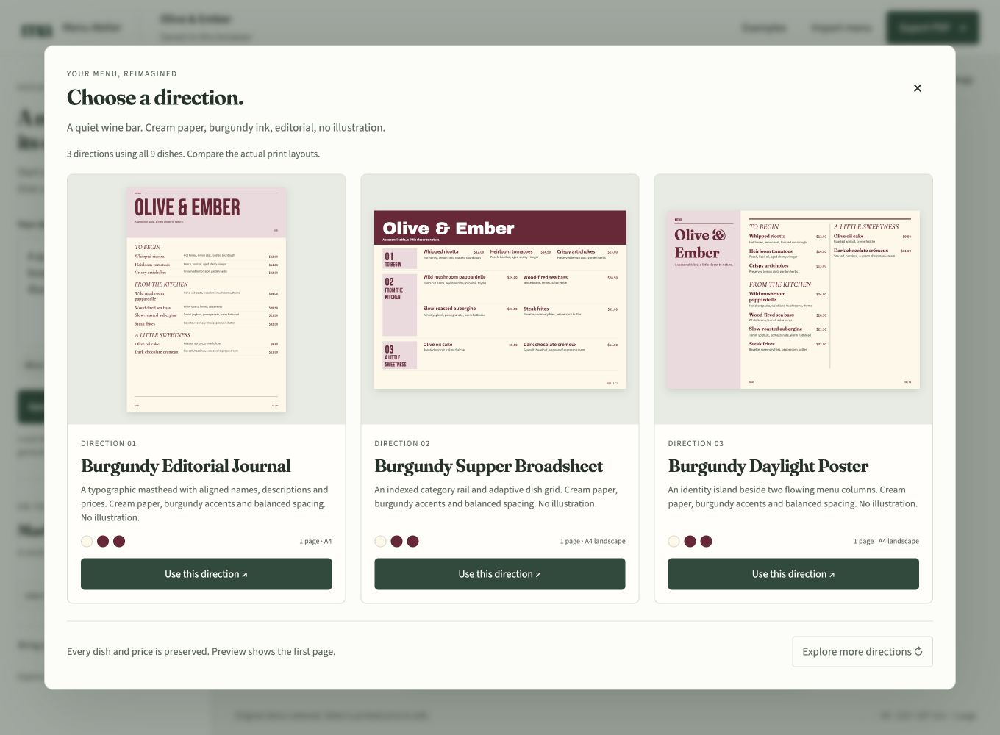

# Menu Atelier

An editable restaurant menu studio from Newgen Labs. Import a menu, review its dishes and prices, write a design brief, compare print directions, refine one and export a selectable PDF.

The generation engine runs locally. It interprets a bounded vocabulary and combines four print architectures with palettes, illustration choices and spacing. It does not call a language model or invent arbitrary layouts. A separate art-direction prompt and validated recipe import let an owner use an AI assistant they already have.

## Try it

- [Owner-private studio](https://menu-atelier-vasu-oct26.zippy17.chatgpt.site/).
- [Seven generated restaurant studies and actual PDFs](https://menu-atelier-vasu-oct26.zippy17.chatgpt.site/generated/).
- [Twelve base architecture exports](https://menu-atelier-vasu-oct26.zippy17.chatgpt.site/grading/).
- [Public source](https://github.com/VasuBansal7576/menu-atelier).



## The workflow

1. Upload TXT, CSV, JSON, a text PDF or an image. Review every extracted name and price.
2. Describe the restaurant's atmosphere, palette, paper orientation and illustration preference. Try the Wine bar, Coastal café or After dark examples.
3. Compare up to three directions using the actual menu. An explicit orientation yields up to two matching architectures.
4. Apply a direction. Select a printed price, enter a new amount and press Done or Enter.
5. Refine the brief, change spacing or edit content. Undo restores menu data and the selected recipe together.
6. Export a PDF or a portable JSON backup. The recipe survives import and browser reload.

Market Bloom uses a produce masthead and category lanes. Folio uses an editorial masthead with separate name, ingredient and price lanes. Sunroom places an identity island beside flowing columns. Night Press uses an indexed category rail and adaptive dish grid. All current artwork consists of original code-drawn vectors. No image-generation assets are included.

Names, descriptions, verified tags and prices remain separate from the design recipe. Prices use integer minor units. The SVG preview and pdf-lib exporter share measured text records from the exact embedded font bytes. A design request cannot silently rewrite menu facts.

## Run

Use Node.js 22.13 or newer.

```sh
npm install
npm start
```

Open the printed localhost address. The core workflow needs no API key. Drafts stay in the current browser. The art-direction prompt contains the owner's brief and category/dish counts. It excludes dish names, descriptions and prices.

## Verify

`npm test` runs 43 behavior and integration checks. They include 72 source/design/paper/spacing PDF round trips, extreme content, original Unicode, geometry, invalid input recovery, recipe validation, selected-stock generation, undo and backup restoration.

`node scripts/grade.mjs --publish-assets` reproduces twelve base-design PDFs and their complete page rasters. `node scripts/generate-studies.mjs` reproduces seven brief-generated restaurant studies. Both use actual PDF output. Rasterization requires Poppler's `pdftoppm`. `python3 scripts/verify-grading.py` requires pypdf and checks saved base exports.

`node scripts/demo-proof.mjs` reproduces the original fictional menu's before/after PDFs. Whipped ricotta changes from $12.00 to $14.50. In the current browser acceptance run, a generated Lime Supper Broadsheet was edited to $16.75, downloaded through the browser and inspected from the saved PDF. Its JSON backup preserved the same recipe and price.

## Planning and implementation

Root scope.md, prd.md and spec.md mirror the canonical records in devpost/. The project began during the submission period. The required Devpost Learn Skill Pack was installed and consulted during development. Pstack Poteto Mode also guided the work. See devpost/checklist.md and devpost/app-map.html for the process and data flow.

The menu model owns validated content and committed history. Import produces reviewable candidates. The print modules own measured page architectures. The design generator produces versioned recipes and adapts immutable scenes. Layout validates the complete printable result. Export writes those same text records and vectors into a native PDF.

The restaurant examples are attributed, unofficial source snapshots. Descriptions are paraphrased. Pizzeria Bianco uses its linked April 2023 menu. The fonts and third-party libraries are disclosed in THIRD_PARTY_NOTICES.md.

## Honest status

The user rejected three previous appearances and a generated-image experiment. Current visual taste remains unverified by the user. Independent reviews establish bounded content and PDF correctness, not a design grade or Gamma-equivalent AI generation.

The narrated demo remains local at the user's request and is excluded from the repository and Site. No new YouTube upload or Devpost entry was submitted. Devpost Create project also failed with a reCAPTCHA timeout while no challenge was visible. A local video does not satisfy the public-video requirement.

OCR is English and requires review. Arbitrary PDF columns may need correction. Unsupported scripts fail preflight without overwriting valid work. Mobile viewport checks were performed; physical-phone testing is not claimed. No performance benchmark is claimed.
